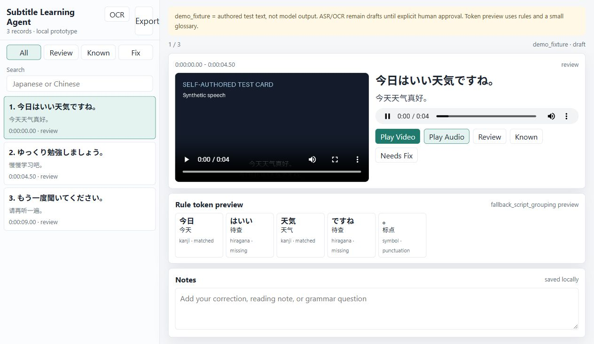

# Subtitle Learning Agent
### An AI-assisted Japanese study prototype built around subtitles

I started this personal project to study Japanese through audiovisual content while practising AI application engineering. It grew from an ASS parser into a runnable local study and correction workflow. Development used substantial AI assistance.

**Status: local learning prototype.** The project name does not imply a complete autonomous agent. It uses existing ASR/OCR models; it does not contain a self-trained model or a multimodal fusion model.

## What works, what is experimental

| Status | Scope |
| --- | --- |
| Implemented workflow | Parse ASS Events/Dialogue, clean tags and line breaks, merge matching time spans, and use style/language heuristics to separate dialogue, lyrics and screen text. |
| Implemented workflow | Extract audio and H.264/AAC video clips with FFmpeg; browse Japanese/Chinese text, replay clips, search, mark study states, save browser notes and export study progress to CSV. |
| Implemented workflow | Sample hard-subtitle frames, crop/preprocess regions, compare clips/crops/text in a review page, save decisions through a local Python HTTP service, and rebuild study data from approved corrections. |
| Experimental | Local faster-whisper transcription and manga-ocr/EasyOCR adapters. Recognition quality and crop selection still need validation. A model confidence/status label is never human approval. |
| Limited preview | Rule-based script grouping and a small Japanese–Chinese glossary. This is not reliable morphology, complete word-by-word translation or JLPT annotation. |
| Future only | Reliable morphology, timeline correction, RAG, Ollama/Qwen integration, and a possible Spring Boot/Vue/MySQL architecture. None is a delivered capability. |

Japanese/Chinese detection and content categories are heuristic. Kanji-only Japanese, unusual ASS layouts, overlap and subtitle timing errors can be misclassified. The pipeline does not automatically repair a timeline.

## Evidence and limits

The original private trial contained **607 raw ASS records, 524 merged records and 20 audiovisual study samples**. All 20 study samples were drafts; there were **zero approved OCR corrections** at the source audit. The original tiny/base comparison covered five clips with manual inspection, without a gold-standard accuracy evaluation. Those media, subtitles, screenshots and learning records are excluded here.

The publication preparation adds a separate, self-authored demonstration:

- Six new ASS lines merge into three study items. Cards, test tones or optional local synthetic speech are generated on the user's machine.
- A fresh core Python environment ran the demo, FFmpeg extraction/cropping and eight regression tests. A Node check covers failed approval saves and recovery.
- The existing local model environment ran tiny ASR on three synthetic-speech clips and each OCR backend on one generated crop. The manga-ocr text visibly differed from the authored line. These are integration smoke tests, **not accuracy benchmarks**.
- Browser checks covered playback, search, state/notes persistence, CSV export, empty-approval rejection, CSV save, rebuild and revocation. Synthetic approval tests by the assistant are not human language validation.

See [validation scope](docs/VALIDATION.md) and [code provenance](docs/PROVENANCE.md). The portable release changes are later AI-assisted work, not evidence that every historical script was previously reproducible.

## Run the self-authored demo

Requirements: Python 3.11+ (tested on Windows with Python 3.13), FFmpeg **and ffprobe** on PATH, and an installed Japanese-capable font. No font, model, video or audio is bundled.

From the checkout root, in Windows PowerShell:

```powershell
python -m venv .venv
.\.venv\Scripts\python.exe -m pip install -r requirements.txt
.\.venv\Scripts\python.exe tools\prepare_demo.py
.\.venv\Scripts\python.exe src\serve_study_app.py
```

Open `http://127.0.0.1:8765/web/`; the review page is `/web/review.html`. These are local pages, not a public demo. Use `--port 18865` if the default port is occupied.

The default demo audio is a **test tone, not Japanese speech**. On Windows, `tools/prepare_demo.py --speech` can instead generate synthetic Japanese speech with an installed SAPI Japanese voice. Supply `--font <installed-font-file>` if font detection fails. On other platforms activate the venv and use `python` for the same scripts.

The demo starts with `demo_fixture` text and OCR `ocr_skipped`: authored fixtures are not recognizer output. Generating a demo refuses to reset existing demo/review data. Use a fresh checkout for another independent input set.



## Review and rebuild

1. Compare the clip, crop, recognition draft and Chinese context.
2. Save a draft or explicitly approve a **non-empty** corrected text. Failed server saves remain browser drafts and never become approvals.
3. Run `python tools/rebuild_data.py`, then reload Study. Approval is not an automatic page-to-dataset update.
4. To revoke an OCR approval, use **Save Draft**, then rebuild. The rebuild starts from the original draft and current ASR/OCR CSVs; approved OCR edits take precedence over approved ASR edits.

Study states (Review/Known/Fix) are personal flags and never approve text. Notes and study states are browser-local. Review decisions are local CSVs. The server is a single-user development service bound to `127.0.0.1`, without authentication or production hardening. Do not expose its port.

See [pipeline commands](docs/PIPELINE.md) for real inputs and optional model calls.

## Project layout

- `src/`: ASS/media/model adapters, correction gates, dataset builders and local server.
- `web/`: vanilla HTML/CSS/JavaScript study and review pages.
- `tools/`: safe demo generation and explicit data rebuild.
- `examples/`: newly authored text-only fixtures and a small glossary.
- `tests/`: approval, persistence, parser and UI failure-path regression checks.
- `data/`: generated/private runtime files; ignored and excluded from publication.

## Before sharing data or results

Only use self-created or clearly licensed input. Do not commit film/audio files, unauthorized subtitles or crops, model weights, personal learning records, absolute machine paths, credentials or clinical data. Generated assets and model results remain local even when based on the demo.

Screenshots above show self-authored cards and fixture text, not film content or an accuracy result. No hosted demo or public benchmark is supplied. A full dependency lock, cross-platform model validation and recognition-quality evaluation remain to be added.

No project-wide open-source license has been selected yet. Third-party packages and models have their own licenses; their weights and code are not vendored here.
